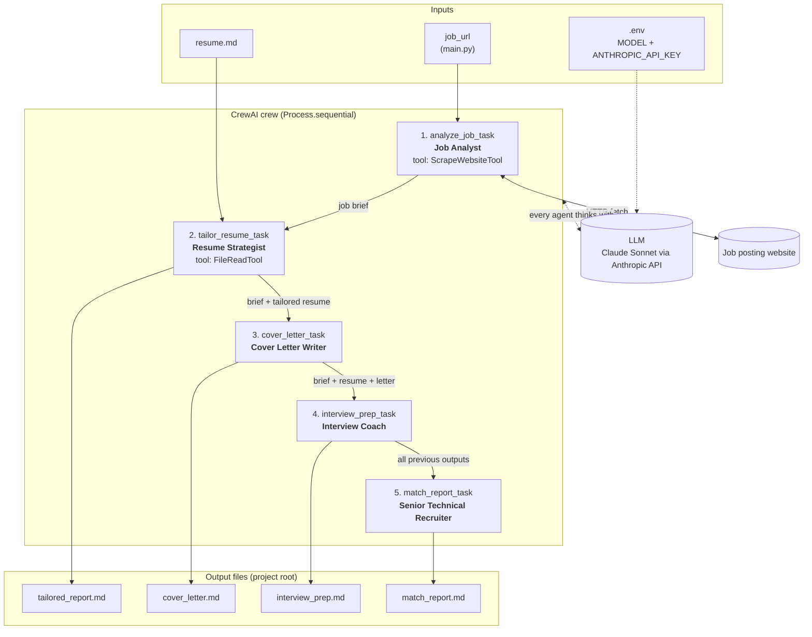
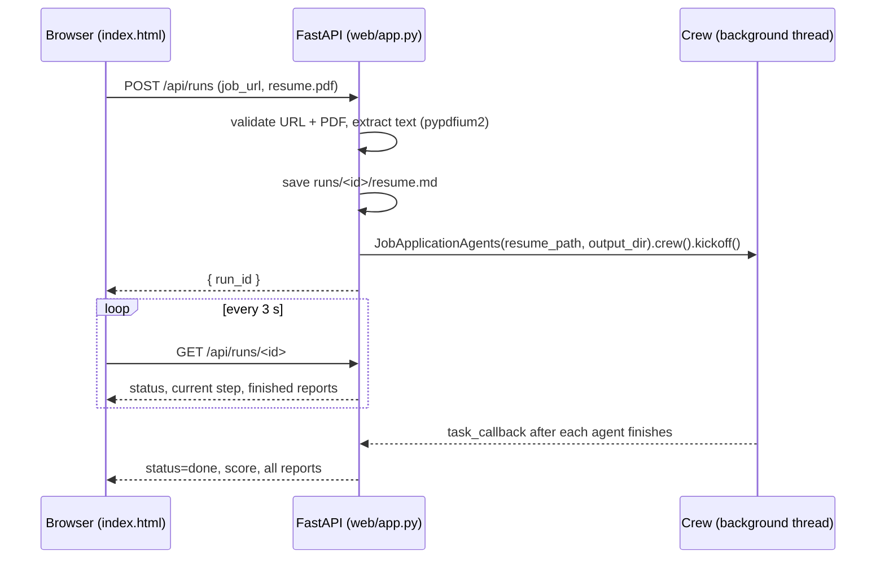

# Job Application Agents

A multi-agent AI workflow built with [CrewAI](https://crewai.com). You give it a job posting URL and your resume. It produces four files: a tailored resume, a cover letter, an interview study sheet and a match report.

---

## Table of contents

1. [What is CrewAI?](#what-is-crewai)
2. [What this project does](#what-this-project-does)
3. [Architecture](#architecture)
4. [How the workflow runs, step by step](#how-the-workflow-runs-step-by-step)
5. [The agents](#the-agents)
6. [Project structure](#project-structure)
7. [Setup](#setup)
8. [Running the crew](#running-the-crew)
9. [Customizing](#customizing)
10. [Troubleshooting](#troubleshooting)

---

## What is CrewAI?

CrewAI is an open-source Python framework for building teams of AI agents that work together on one goal. Each agent works like a specialist on a human team: it has its own job, its own instructions and its own tools.

Its main building blocks:

| Concept | What it is | In this project |
|---|---|---|
| **Agent** | An LLM given a **role**, a **goal** and a **backstory**, plus optional **tools**. | 5 specialists (job analyst, resume strategist, and so on), defined in `config/agents.yaml`. |
| **Task** | A piece of work with a `description`, an `expected_output` and the `agent` that does it. | 5 tasks, defined in `config/tasks.yaml`. |
| **Tool** | A function an agent can call to act outside the LLM, such as reading a web page or a file. | `ScrapeWebsiteTool` and `FileReadTool`. |
| **Crew** | The team: a list of agents and tasks, plus a **process** that sets the order of the work. | `JobApplicationAgents.crew()` in `crew.py`. |
| **Process** | How tasks are scheduled. In `sequential`, tasks run one after another, and each task sees the outputs of the tasks before it. In `hierarchical`, a manager agent delegates the work. | `Process.sequential` |
| **Inputs** | Values filled into `{placeholders}` in the YAML when the crew starts. | `{job_url}` |
| **LLM** | The model that powers each agent, set with `MODEL` in `.env`. | `anthropic/claude-sonnet-5-5` |

CrewAI's main advantage is that the agents are defined in YAML, separate from the Python code. You can change an agent's role or a task's instructions without touching any code.

---

## What this project does

| Input | Output |
|---|---|
| `job_url`, a link to a job posting (set in `main.py`) | `tailored_report.md`: your resume rewritten around the job's keywords |
| `resume.md`, your resume in Markdown | `cover_letter.md`: a personalized cover letter of 200-250 words |
| | `interview_prep.md`: 6-8 likely interview questions with model answers |
| | `match_report.md`: a match score out of 100, your strengths, and gaps to fix |

The agents are told never to invent experience. They rephrase and reprioritize what is already in your resume.

---

## Architecture



GitHub and the VS Code Markdown preview both draw this diagram automatically. In VS Code, the preview may need a Mermaid extension. Here is the same flow as plain text:

```
 job_url ──► [1] Job Analyst ──(scrapes posting)──► job brief
                                                     │
 resume.md ─► [2] Resume Strategist ◄────────────────┘ ──► tailored_report.md
                         │
                         ▼
             [3] Cover Letter Writer ─────────────────────► cover_letter.md
                         │
                         ▼
             [4] Interview Coach ─────────────────────────► interview_prep.md
                         │
                         ▼
             [5] Senior Technical Recruiter ─────────────► match_report.md

  Every agent calls the LLM configured in .env (Claude Sonnet).
```

---

## How the workflow runs, step by step

### Step 0: Startup (`main.py`)
1. `run()` is the entry point; both `crewai run` and `run_crew.exe` call it.
2. `truststore.inject_into_ssl()` makes Python use the Windows certificate store, so HTTPS works on networks that inspect TLS traffic.
3. `inputs = {"job_url": "..."}` sets the posting to analyze.
4. `JobApplicationAgents().crew().kickoff(inputs=inputs)` starts the crew.

### Step 1: Building the crew (`crew.py`)
1. The `@CrewBase` decorator loads `config/agents.yaml` and `config/tasks.yaml`.
2. Each `@agent` method creates an `Agent` from its YAML entry and attaches its tools:
   - The **job analyst** gets `ScrapeWebsiteTool()` to read web pages.
   - The **resume strategist** gets `FileReadTool(file_path=resume.md)`, which can read only your resume.
3. Each `@task` method creates a `Task`. Four of them set `output_file`, so their result is saved as a `.md` file.
4. `@crew` puts the agents and tasks into a `Crew` with `Process.sequential`.
5. CrewAI replaces `{job_url}` in the YAML with the value from `inputs`.

### Step 2: Analyze the job (Job Analyst)
- The agent calls `ScrapeWebsiteTool` on `job_url` and reads the posting.
- It produces a **job brief**: the role and company, the 5-8 must-have requirements, keywords to mirror, priorities and red flags.
- If the page can't be loaded (for example, the posting is closed and returns 404), it falls back to what it can find on the site. Everything after this step then becomes more generic.

### Step 3: Tailor the resume (Resume Strategist)
- It reads `resume.md` with `FileReadTool`.
- It rewrites the resume using the job brief: a short summary aimed at the role, and keyword-matched, quantified bullet points. It does not invent anything.
- **Output:** `tailored_report.md`

### Step 4: Write the cover letter (Cover Letter Writer)
- It uses the job brief and the tailored resume, which reach it through the sequential process.
- It writes a 200-250 word letter: a strong opening, 1-2 paragraphs of evidence and a confident close.
- **Output:** `cover_letter.md`

### Step 5: Prepare for the interview (Interview Coach)
- It predicts technical, behavioural and managerial questions for the role.
- It writes a short model answer for each, using your actual experience.
- **Output:** `interview_prep.md`

### Step 6: Review the application (Senior Technical Recruiter)
- It reviews the whole package: the brief, the resume and the cover letter.
- It gives a blunt **match score out of 100**, your strengths, a prioritized list of gaps to fix, and a one-line verdict.
- **Output:** `match_report.md`

### How information passes between agents
With `Process.sequential`, CrewAI automatically passes the outputs of earlier tasks into each later task's prompt. That's why the tasks don't need an explicit `context=[...]`. Each agent is like a team member who gets the previous person's work handed over.

### What happens on each LLM call
Each agent works in a loop: **think → (optionally) call a tool → read the result → think again**. The loop ends when the agent produces a final answer that matches its task's `expected_output`. Every step of that loop is a call to the model set in `MODEL`.

---

## The agents

| # | Agent (YAML key) | Role | Tools | Task | Output file |
|---|---|---|---|---|---|
| 1 | `job_analyst` | Job analyst | `ScrapeWebsiteTool` | `analyze_job_task` | none (passed to the next tasks) |
| 2 | `resume_strategist` | Resume Tailoring Expert | `FileReadTool` | `tailor_resume_task` | `tailored_report.md` |
| 3 | `cover_letter_writer` | Cover Letter Writer | none | `cover_letter_task` | `cover_letter.md` |
| 4 | `interview_coach` | Interview preparation coach | none | `interview_prep_task` | `interview_prep.md` |
| 5 | `application_critics` | Senior Technical Recruiter | none | `match_report_task` | `match_report.md` |

---

## Project structure

```
job_application_agents/
├── .env                    # MODEL + ANTHROPIC_API_KEY (secret, git-ignored)
├── .env.example            # Template for .env (safe to commit)
├── pyproject.toml          # Dependencies + script entry points
├── uv.lock                 # Locked dependency versions
├── knowledge/
│   └── user_preference.txt # Sample knowledge file (not wired into the crew yet)
└── src/job_application_agents/
    ├── main.py             # CLI entry point: inputs + kickoff
    ├── web/
    │   ├── app.py          # FastAPI server: upload, run crew, progress API
    │   └── static/index.html  # Single-page UI
    ├── crew.py             # Agents, tasks, tools, crew definition
    ├── resume.md           # YOUR resume (input)
    ├── config/
    │   ├── agents.yaml     # Role / goal / backstory for each agent
    │   └── tasks.yaml      # Description / expected output for each task
    └── tools/
        └── custom_tool.py  # Template for writing your own tool
```

---

## Setup

**Requirements:** Python 3.10-3.13 and [uv](https://docs.astral.sh/uv/).

1. **Install uv**, if you don't have it:
   ```powershell
   winget install --id astral-sh.uv -e --source winget
   ```
2. **Install the dependencies.** Run this from the `job_application_agents` folder:
   ```powershell
   uv sync
   ```
   If your network inspects HTTPS traffic, add `--system-certs`.
3. **Configure the LLM.** Copy `.env.example` to `.env` and add your key:
   ```
   MODEL=anthropic/claude-sonnet-5-5
   ANTHROPIC_API_KEY=your-key-from-console.anthropic.com
   ```
   Never commit `.env`; it is already in `.gitignore`.
4. **Add your resume.** Paste it into `src/job_application_agents/resume.md`.
5. **Set the job.** Change `job_url` in `src/job_application_agents/main.py` to a live posting.

---

## Running the crew

Run these from the `job_application_agents` folder, not its parent:

```powershell
cd job_application_agents
crewai run
# or, without the CrewAI CLI:
.\.venv\Scripts\run_crew.exe
```

The terminal shows each agent's reasoning and tool calls as they happen. When the run finishes, the four `.md` output files are in the `job_application_agents` folder.

---

## Website

The project includes a local website that runs the same crew from your browser. You give it a **job URL** and a **resume PDF**, and it shows the match score, tailored resume, cover letter, interview prep and job brief in tabs. Each tab has buttons to copy or download it.

**Start it** from the `job_application_agents` folder:

```powershell
uv run web
# or
.\.venv\Scripts\web.exe
```

Then open **http://127.0.0.1:8000**.



How it works:
- **Upload checks:** the URL must be http(s). The file must be a real PDF, no larger than 5 MB, and contain readable text. Scanned image PDFs are rejected with a clear message.
- **Per-run isolation:** each run gets its own `runs/<id>/` folder for the extracted resume and the 4 output files. The resume tool is locked to that run's file.
- **One run at a time:** a second submission during a run gets a "try again" message. This protects your API credits.
- **Live progress:** after each agent finishes, a callback (`task_callback`) updates the progress tracker, and the page polls it.
- **Safe rendering:** reports are converted from Markdown to HTML and then sanitized with DOMPurify, so text from a scraped page can't inject scripts.
- **Local only:** the server listens on `127.0.0.1`. Set `WEB_HOST` and `WEB_PORT` to change this. Runs are kept in memory, so restarting the server forgets them, but their files stay in `runs/`.
- `runs/` is git-ignored because it holds personal resume data.

---

## Customizing

| To change… | Edit |
|---|---|
| The job being analyzed | `job_url` in `main.py` |
| An agent's personality or focus | `config/agents.yaml` |
| What a task produces (length, format) | `config/tasks.yaml` |
| Tools, output files, process type | `crew.py` |
| The model | `MODEL` in `.env`, e.g. `anthropic/claude-haiku-5-5` for a cheaper run, or `openai/gpt-4o` with `OPENAI_API_KEY` |
| Add a custom tool | `tools/custom_tool.py`, then attach it to an agent in `crew.py` |

---

## Troubleshooting

| Symptom | Cause | Fix |
|---|---|---|
| `FileNotFoundError: pyproject.toml` | `crewai run` was started from the wrong folder | `cd job_application_agents` first |
| `OPENSSL_Uplink ... no OPENSSL_Applink` | The `SSLKEYLOGFILE` environment variable is set | `Remove-Item Env:SSLKEYLOGFILE`, or delete it from your Windows environment variables |
| `CERTIFICATE_VERIFY_FAILED` / `APIConnectionError` | Your network inspects HTTPS traffic | Already handled by `truststore` in `main.py`. For uv, add `--system-certs`. |
| `[WinError 2]` on `crewai run` | `uv` is not installed or not on PATH | Install uv and open a new terminal |
| Output is generic / "Job not found" | The job posting is closed (HTTP 404) | Use a live posting URL |
| `401 authentication_error` | The API key is missing or invalid | Check `ANTHROPIC_API_KEY` in `.env` |

---

## Learn more

- CrewAI docs: https://docs.crewai.com
- CrewAI on GitHub: https://github.com/crewAIInc/crewAI
