# Job Application Agents

A multi-agent AI workflow built with [CrewAI](https://crewai.com). You give it a job posting URL and your resume. It produces four files: a tailored resume, a cover letter, an interview study sheet and a match report.

---

## Table of contents

1. [What is CrewAI?](#what-is-crewai)
2. [What this project does](#what-this-project-does)
3. [Architecture](#architecture)
4. [How the workflow runs, step by step](#how-the-workflow-runs-step-by-step)
5. [The agents](#the-agents)
6. [Project structure](#project-structure)
7. [Setup](#setup)
8. [Running the crew](#running-the-crew)
9. [Website](#website)
10. [Step-by-step walkthrough (with screenshots)](#step-by-step-walkthrough-with-screenshots)
11. [Trying it with the sample resume](#trying-it-with-the-sample-resume)
12. [Customizing](#customizing)
13. [Troubleshooting](#troubleshooting)

---

## What is CrewAI?

CrewAI is an open-source Python framework for building teams of AI agents that work together on one goal. Each agent works like a specialist on a human team: it has its own job, its own instructions and its own tools.

Its main building blocks:

| Concept | What it is | In this project |
|---|---|---|
| **Agent** | An LLM given a **role**, a **goal** and a **backstory**, plus optional **tools**. | 5 specialists (job analyst, resume strategist, and so on), defined in `config/agents.yaml`. |
| **Task** | A piece of work with a `description`, an `expected_output` and the `agent` that does it. | 5 tasks, defined in `config/tasks.yaml`. |
| **Tool** | A function an agent can call to act outside the LLM, such as reading a web page or a file. | `ScrapeWebsiteTool` and `FileReadTool`. |
| **Crew** | The team: a list of agents and tasks, plus a **process** that sets the order of the work. | `JobApplicationAgents.crew()` in `crew.py`. |
| **Process** | How tasks are scheduled. In `sequential`, tasks run one after another, and each task sees the outputs of the tasks before it. In `hierarchical`, a manager agent delegates the work. | `Process.sequential` |
| **Inputs** | Values filled into `{placeholders}` in the YAML when the crew starts. | `{job_url}` |
| **LLM** | The model that powers each agent, set with `MODEL` in `.env`. | `anthropic/claude-sonnet-5-5` |

CrewAI's main advantage is that the agents are defined in YAML, separate from the Python code. You can change an agent's role or a task's instructions without touching any code.

---

## What this project does

| Input | Output |
|---|---|
| `job_url`, a link to a job posting (from `main.py`, or typed into the website) | `tailored_report.md`: your resume rewritten around the job's keywords |
| Your resume: `resume.md` for the CLI, or a **PDF upload** on the website | `cover_letter.md`: a personalized cover letter of 200-250 words |
| | `interview_prep.md`: 6-8 likely interview questions with model answers |
| | `match_report.md`: a match score out of 100, your strengths, and gaps to fix |

There are two ways to run it: the **command line** (`crewai run`) and a **local website** (`uv run web`). Both run the same crew.

The agents are told never to invent experience. They rephrase and reprioritize what is already in your resume.

---

## Architecture

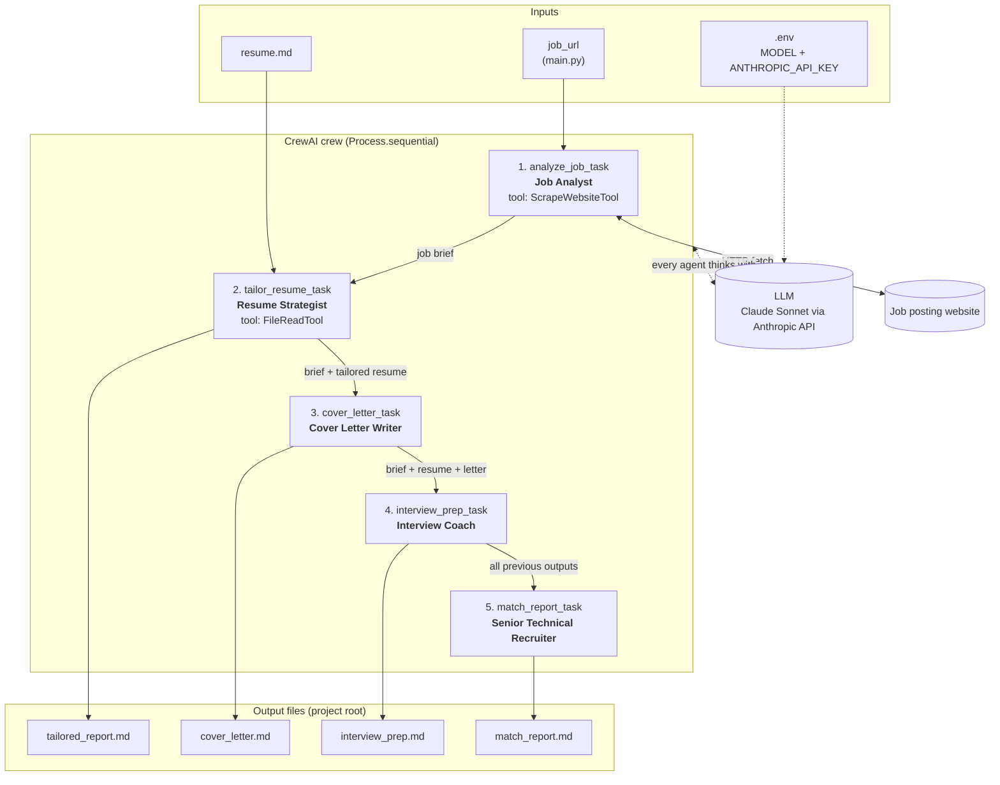

GitHub and the VS Code Markdown preview both draw this diagram automatically. In VS Code, the preview may need a Mermaid extension. Here is the same flow as plain text:

```
 job_url ──► [1] Job Analyst ──(scrapes posting)──► job brief
                                                     │
 resume.md ─► [2] Resume Strategist ◄────────────────┘ ──► tailored_report.md
                         │
                         ▼
             [3] Cover Letter Writer ─────────────────────► cover_letter.md
                         │
                         ▼
             [4] Interview Coach ─────────────────────────► interview_prep.md
                         │
                         ▼
             [5] Senior Technical Recruiter ─────────────► match_report.md

  Every agent calls the LLM configured in .env (Claude Sonnet).
```

---

## How the workflow runs, step by step

### Step 0: Startup (`main.py`)
1. `run()` is the entry point; both `crewai run` and `run_crew.exe` call it.
2. `SSLKEYLOGFILE` is removed from this process's environment. On Windows, that variable makes Python's OpenSSL crash (`OPENSSL_Uplink`).
3. `truststore.inject_into_ssl()` makes Python use the Windows certificate store, so HTTPS works on networks that inspect TLS traffic.
4. `inputs = {"job_url": "..."}` sets the posting to analyze.
5. `JobApplicationAgents().crew().kickoff(inputs=inputs)` starts the crew.

The website (`web/app.py`) goes through the same startup steps. It then builds the crew with `JobApplicationAgents(resume_path=..., output_dir="runs/<id>")` for each upload.

### Step 1: Building the crew (`crew.py`)
1. The `@CrewBase` decorator loads `config/agents.yaml` and `config/tasks.yaml`.
2. The constructor takes two optional per-run settings:
   - `resume_path`: the resume file to read. It defaults to `src/job_application_agents/resume.md`.
   - `output_dir`: a relative folder for the output files. It defaults to `""`, which means the project root.
3. Each `@agent` method creates an `Agent` from its YAML entry and attaches its tools:
   - The **job analyst** gets `ScrapeWebsiteTool()` to read web pages.
   - The **resume strategist** gets `FileReadTool(file_path=self.resume_path)`. The tool is locked to that one file, so the agent can't read anything else on disk.
4. Each `@task` method creates a `Task`. Four of them set `output_file` (through `self._out(...)`), so their result is saved as a `.md` file in `output_dir`.
5. `@crew` puts the agents and tasks into a `Crew` with `Process.sequential`.
5. CrewAI replaces `{job_url}` in the YAML with the value from `inputs`.

### Step 2: Analyze the job (Job Analyst)
- The agent calls `ScrapeWebsiteTool` on `job_url` and reads the posting.
- It produces a **job brief**: the role and company, the 5-8 must-have requirements, keywords to mirror, priorities and red flags.
- If the page can't be loaded (for example, the posting is closed and returns 404), it falls back to what it can find on the site. Everything after this step then becomes more generic.

### Step 3: Tailor the resume (Resume Strategist)
- It reads `resume.md` with `FileReadTool`.
- It rewrites the resume using the job brief: a short summary aimed at the role, and keyword-matched, quantified bullet points. It does not invent anything.
- **Output:** `tailored_report.md`

### Step 4: Write the cover letter (Cover Letter Writer)
- It uses the job brief and the tailored resume, which reach it through the sequential process.
- It writes a 200-250 word letter: a strong opening, 1-2 paragraphs of evidence and a confident close.
- **Output:** `cover_letter.md`

### Step 5: Prepare for the interview (Interview Coach)
- It predicts technical, behavioural and managerial questions for the role.
- It writes a short model answer for each, using your actual experience.
- **Output:** `interview_prep.md`

### Step 6: Review the application (Senior Technical Recruiter)
- It reviews the whole package: the brief, the resume and the cover letter.
- It gives a blunt **match score out of 100**, your strengths, a prioritized list of gaps to fix, and a one-line verdict.
- **Output:** `match_report.md`

### How information passes between agents
With `Process.sequential`, CrewAI automatically passes the outputs of earlier tasks into each later task's prompt. That's why the tasks don't need an explicit `context=[...]`. Each agent is like a team member who gets the previous person's work handed over.

### What happens on each LLM call
Each agent works in a loop: **think → (optionally) call a tool → read the result → think again**. The loop ends when the agent produces a final answer that matches its task's `expected_output`. Every step of that loop is a call to the model set in `MODEL`.

---

## The agents

| # | Agent (YAML key) | Role | Tools | Task | Output file |
|---|---|---|---|---|---|
| 1 | `job_analyst` | Job analyst | `ScrapeWebsiteTool` | `analyze_job_task` | none (passed to the next tasks) |
| 2 | `resume_strategist` | Resume Tailoring Expert | `FileReadTool` | `tailor_resume_task` | `tailored_report.md` |
| 3 | `cover_letter_writer` | Cover Letter Writer | none | `cover_letter_task` | `cover_letter.md` |
| 4 | `interview_coach` | Interview preparation coach | none | `interview_prep_task` | `interview_prep.md` |
| 5 | `application_critics` | Senior Technical Recruiter | none | `match_report_task` | `match_report.md` |

---

## Project structure

```
job_application_agents/
├── .env                    # MODEL + ANTHROPIC_API_KEY (secret, git-ignored)
├── .env.example            # Template for .env (safe to commit)
├── pyproject.toml          # Dependencies + script entry points
├── uv.lock                 # Locked dependency versions
├── docs/screenshots/       # Website screenshots used in this README
├── samples/
│   ├── make_sample_resume.py  # Builds a fictional test resume PDF
│   └── sample_resume.pdf      # "Jordan Rivera" (fictional), for website testing
├── runs/                   # Website uploads + outputs, one folder per run (git-ignored)
├── knowledge/
│   └── user_preference.txt # Sample knowledge file (not wired into the crew yet)
└── src/job_application_agents/
    ├── main.py             # CLI entry point: inputs + kickoff
    ├── web/
    │   ├── app.py          # FastAPI server: upload, run crew, progress API
    │   └── static/index.html  # Single-page UI
    ├── crew.py             # Agents, tasks, tools, crew definition
    ├── resume.md           # YOUR resume (input)
    ├── config/
    │   ├── agents.yaml     # Role / goal / backstory for each agent
    │   └── tasks.yaml      # Description / expected output for each task
    └── tools/
        └── custom_tool.py  # Template for writing your own tool
```

---

## Setup

**Requirements:** Python 3.10-3.13 and [uv](https://docs.astral.sh/uv/).

1. **Install uv**, if you don't have it:
   ```powershell
   winget install --id astral-sh.uv -e --source winget
   ```
2. **Install the dependencies.** Run this from the `job_application_agents` folder:
   ```powershell
   uv sync
   ```
   If your network inspects HTTPS traffic, add `--system-certs`.
3. **Configure the LLM.** Copy `.env.example` to `.env` and add your key:
   ```
   MODEL=anthropic/claude-sonnet-5-5
   ANTHROPIC_API_KEY=your-key-from-console.anthropic.com
   ```
   Never commit `.env`; it is already in `.gitignore`.
4. **Add your resume.** For the CLI, paste it into `src/job_application_agents/resume.md`. The website doesn't use this file; you upload a PDF there instead.
5. **Set the job.** For the CLI, change `job_url` in `src/job_application_agents/main.py` to a live posting. The default URL points to a Scale AI posting that has since closed. On the website, you type the URL into the form.

---

## Running the crew

You can run the crew from the command line instead of the website. Here are the steps:

1. **Add your resume** to `src/job_application_agents/resume.md` (plain text or Markdown).
2. **Set the job URL** in `src/job_application_agents/main.py`:
   ```python
   inputs = {'job_url': "https://job-boards.greenhouse.io/scaleai/jobs/4633072005"}
   ```
3. **Run it** from the `job_application_agents` folder, not its parent:
   ```powershell
   cd job_application_agents
   crewai run
   # or, without the CrewAI CLI:
   .\.venv\Scripts\run_crew.exe
   ```
4. **Watch the terminal.** Each agent prints a panel as it starts, its tool calls (for example `Tool: read_website_content`), and its final answer.
5. **Read the outputs.** When the run finishes, `tailored_report.md`, `cover_letter.md`, `interview_prep.md` and `match_report.md` are in the `job_application_agents` folder. Each run overwrites the previous files.

---

## Website

The project includes a local website that runs the same crew from your browser. You give it a **job URL** and a **resume PDF**, and it shows the match score, tailored resume, cover letter, interview prep and job brief in tabs. Each tab has buttons to copy or download it.

**Start it** from the `job_application_agents` folder:

```powershell
uv run web
# or
.\.venv\Scripts\web.exe
```

Then open **http://127.0.0.1:8000**.

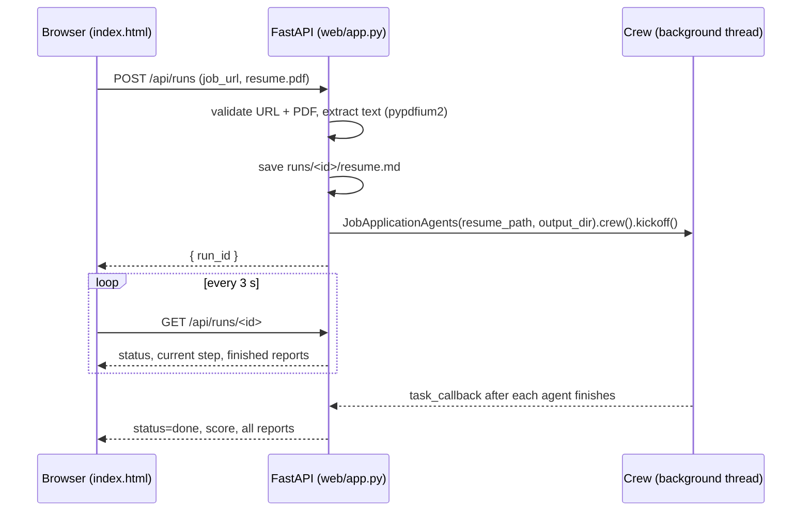

How it works:
- **Upload checks:** the URL must be http(s). The file must be a real PDF, no larger than 5 MB, and contain readable text. Scanned image PDFs are rejected with a clear message.
- **Per-run isolation:** each run gets its own `runs/<id>/` folder for the extracted resume and the 4 output files. The resume tool is locked to that run's file.
- **One run at a time:** a second submission during a run gets a "try again" message. This protects your API credits.
- **Live progress:** after each agent finishes, a callback (`task_callback`) updates the progress tracker, and the page polls it. CrewAI can fire this callback asynchronously, so the final reports and the score are taken from the return value of `kickoff()`.
- **Match score:** read from the match report's `Match score: X/100` line and shown as a colour-coded dial. Green means 75 or more, amber 55-74, red below 55.
- **Refresh-safe:** the page remembers the current run in `localStorage`, so reloading the page picks the run back up.
- **Safe rendering:** reports are converted from Markdown to HTML and then sanitized with DOMPurify, so text from a scraped page can't inject scripts.
- **Local only:** the server listens on `127.0.0.1`. Set `WEB_HOST` and `WEB_PORT` to change this. Runs are kept in memory, so restarting the server forgets them, but their files stay in `runs/`.
- `runs/` is git-ignored because it holds personal resume data.

---

## Step-by-step walkthrough (with screenshots)

This walkthrough follows one complete run: the fictional sample resume against Scale AI's live posting [Technical Program Manager, Public Sector](https://job-boards.greenhouse.io/scaleai/jobs/4633072005).

### Step 1: Start the server

From the `job_application_agents` folder:

```powershell
.\.venv\Scripts\web.exe        # or: uv run web
```

The terminal prints:

```
  Job Application Agents → http://127.0.0.1:8000
INFO:     Uvicorn running on http://127.0.0.1:8000 (Press CTRL+C to quit)
```

Leave this terminal open. The agents' detailed reasoning and tool calls appear here while a run is in progress.

### Step 2: Open the website

Go to **http://127.0.0.1:8000** in your browser. You'll see the form with its two inputs.

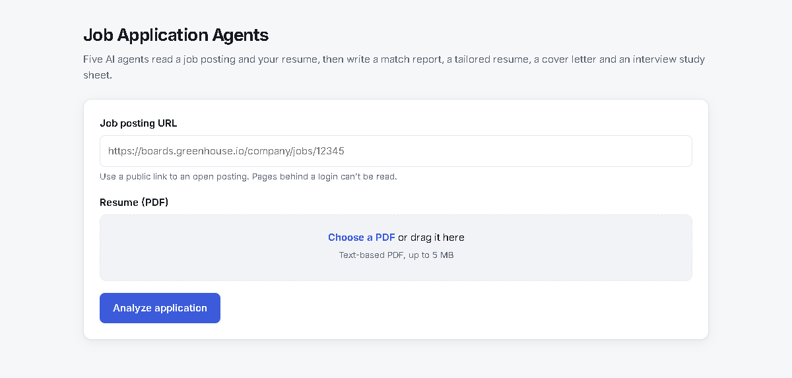

### Step 3: Enter the job posting URL

Paste the full link to an **open** job posting. The form checks your input before sending anything to the server. For example, if you click **Analyze application** before choosing a resume, you get this message:

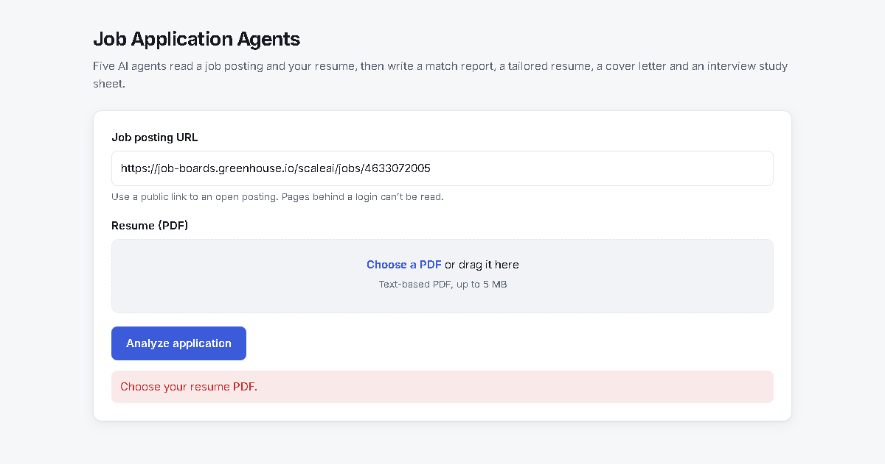

The server also rejects these:
- URLs that don't start with `http://` or `https://`
- Files that aren't PDFs
- PDFs over 5 MB
- Scanned PDFs with no readable text

### Step 4: Upload your resume PDF

Click **Choose a PDF**, or drag the file onto the upload area. The file name appears once it's selected. Then click **Analyze application**.

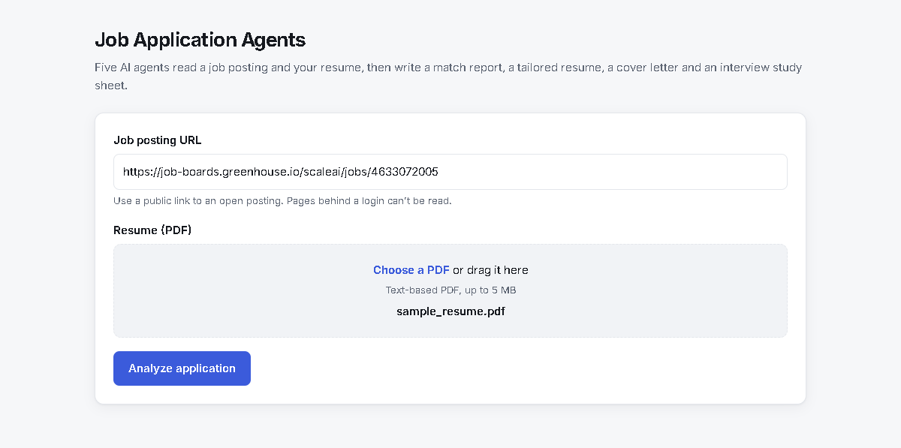

When you submit, the server does the following (see [Website](#website)):
1. Extracts the text from the PDF.
2. Saves it to `runs/<id>/resume.md`.
3. Starts the crew in a background thread.

### Step 5: Watch the agents work

The progress tracker shows which of the 5 agents is working:
- A green tick means that agent has finished.
- A spinning ring marks the agent working now.
- An empty circle means the agent hasn't started yet.

A full run usually takes **3-6 minutes**. You can refresh the page at any time and it will pick the run back up.

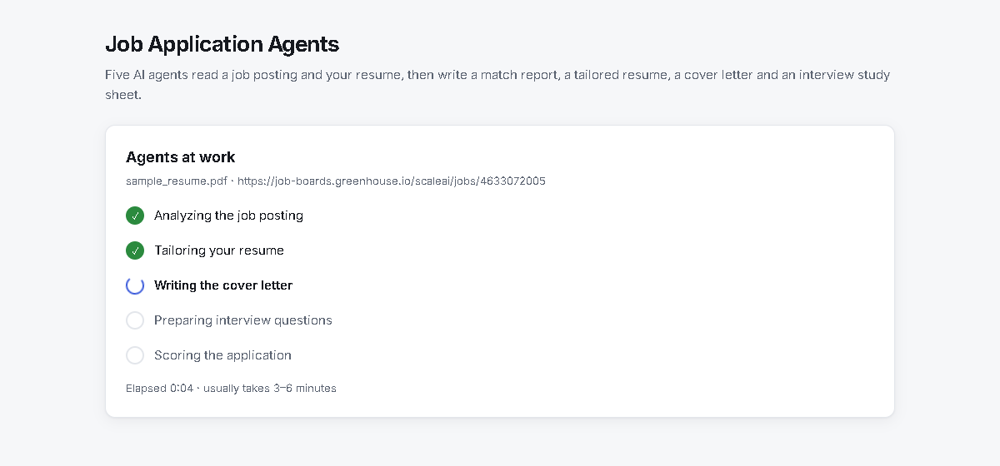

| Step on screen | Agent | What it's doing |
|---|---|---|
| Analyzing the job posting | Job Analyst | Scrapes the URL and extracts must-haves, keywords and red flags |
| Tailoring your resume | Resume Strategist | Reads your resume and rewrites it around the job brief |
| Writing the cover letter | Cover Letter Writer | Writes a 200-250 word personalized letter |
| Preparing interview questions | Interview Coach | Predicts likely questions and writes model answers |
| Scoring the application | Senior Technical Recruiter | Scores the match and lists gaps to fix |

### Step 6: Read the match score and match report

When the run finishes, the page shows the **match score dial** and opens the **Match report** tab. The report lists your strengths, the gaps to fix before applying (in priority order), and a one-line verdict.

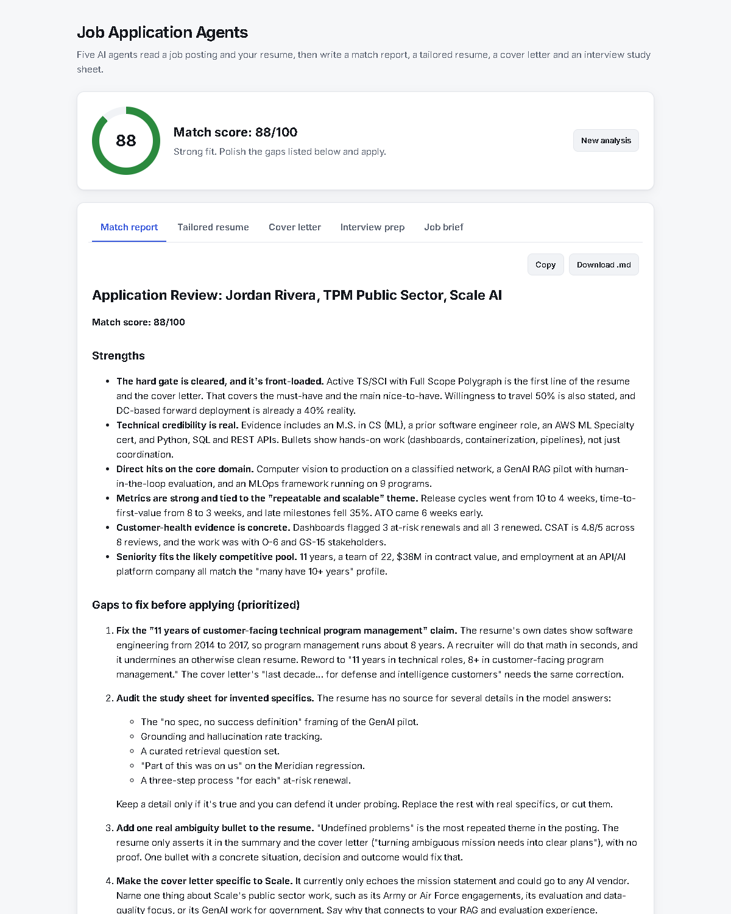

Every tab has two buttons:
- **Copy** puts the report on your clipboard as Markdown.
- **Download .md** saves it as a file.

**New analysis** takes you back to the form.

### Step 7: Review the tailored resume

The **Tailored resume** tab has your resume rewritten around the job's keywords. It has a role-focused summary and quantified bullets, and nothing invented.

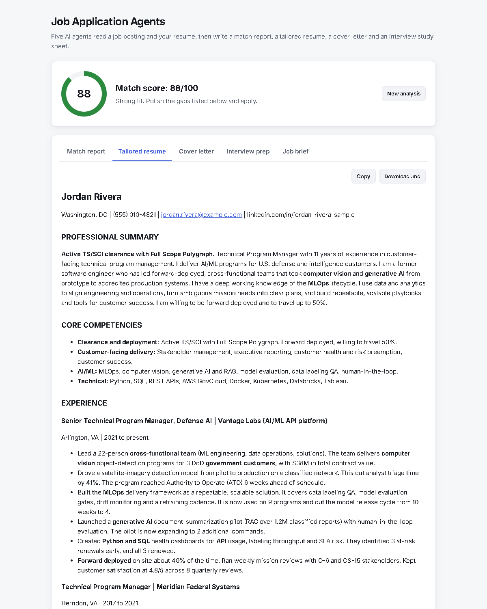

### Step 8: Review the cover letter

The **Cover letter** tab has a ready-to-edit letter with an opening, 1-2 paragraphs of evidence and a close.

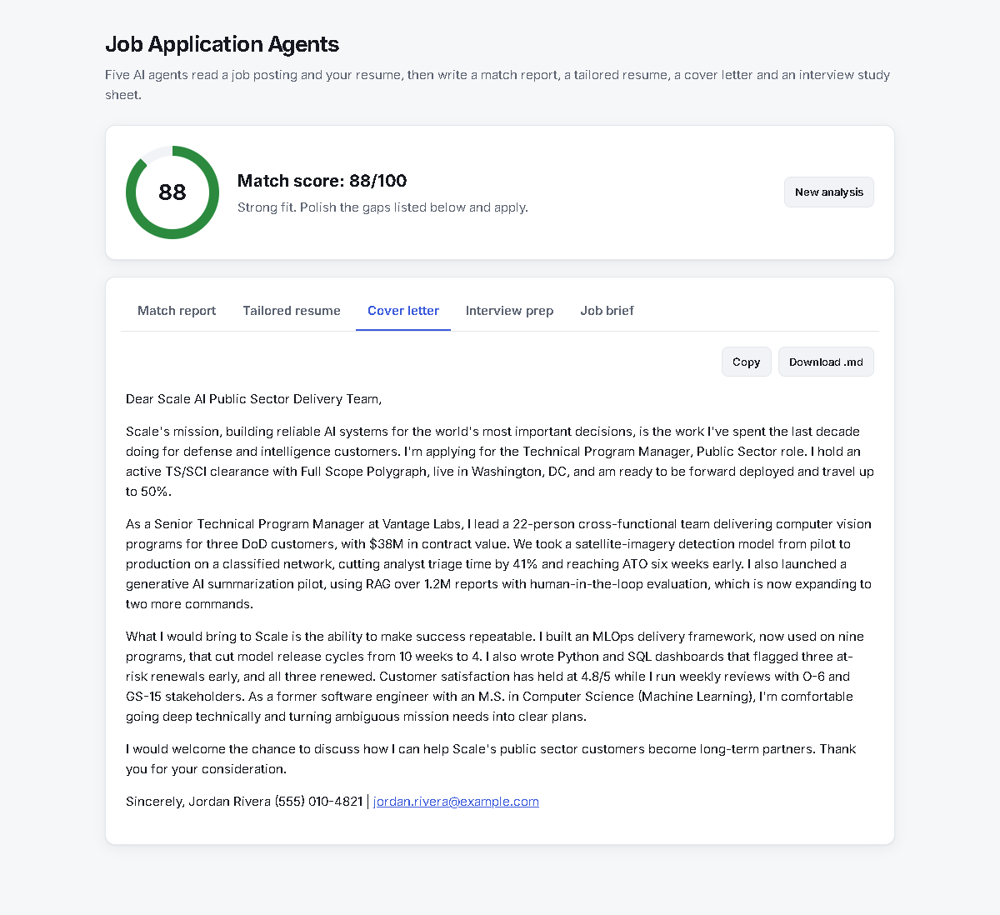

### Step 9: Prepare with the interview study sheet

The **Interview prep** tab has 6-8 likely technical, behavioural and managerial questions, each with a model answer based on your experience.

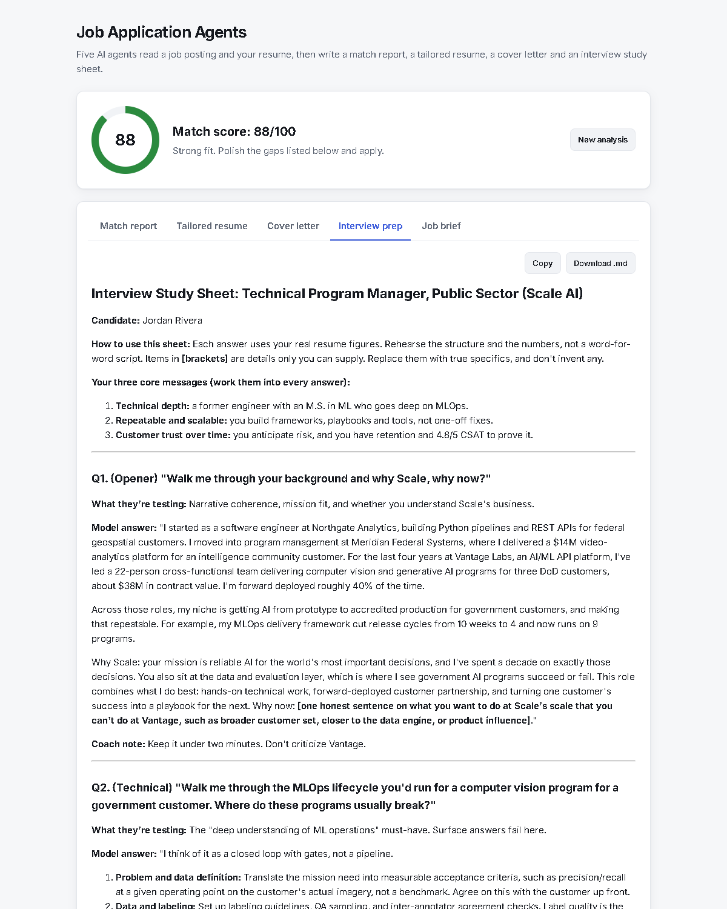

### Step 10: Check the job brief

The **Job brief** tab shows what the Job Analyst extracted from the posting: the role, the must-haves, the keywords and any red flags. If the other reports look off, check this tab first. A closed or unreadable posting shows up here.

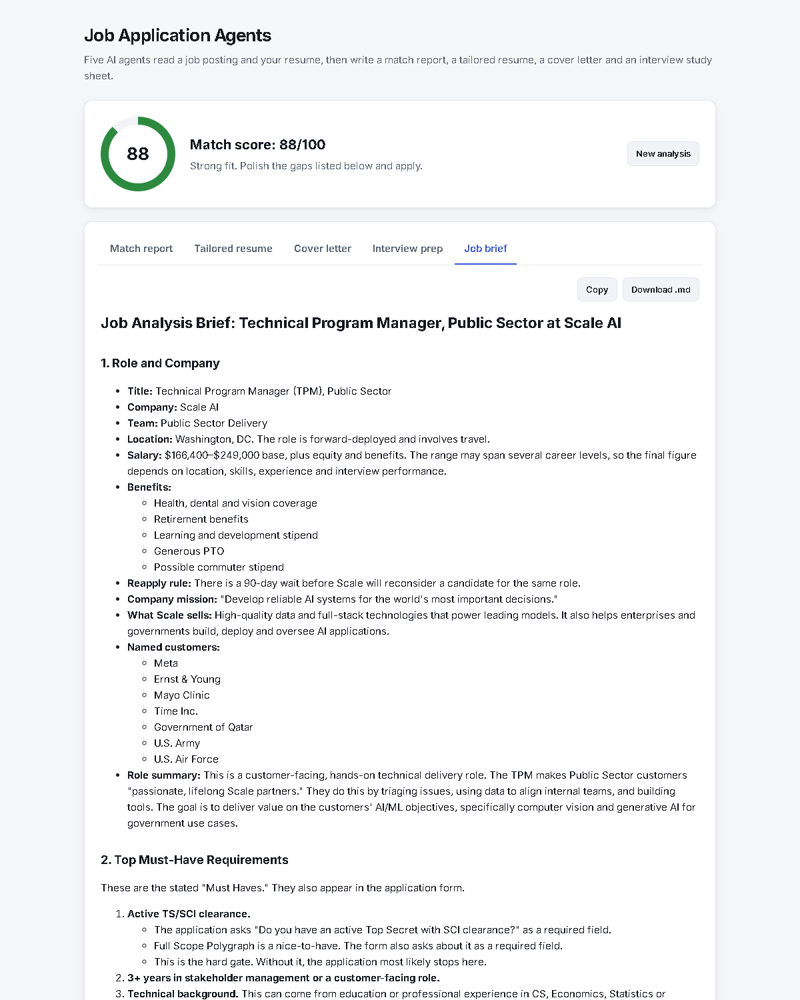

### Step 11: Find the files on disk

Each run's files are also saved in `runs/<run_id>/`:

```
runs/4c9047d509fc/
├── resume.md            # text extracted from your PDF
├── tailored_report.md
├── cover_letter.md
├── interview_prep.md
└── match_report.md
```

To stop the server, press **Ctrl+C** in its terminal.

---

## Trying it with the sample resume

`samples/sample_resume.pdf` is a **fictional** one-page resume for "Jordan Rivera", a Technical Program Manager. It was written for Scale AI's live posting [Technical Program Manager, Public Sector](https://job-boards.greenhouse.io/scaleai/jobs/4633072005). It covers that role's must-haves: an active TS/SCI clearance, MLOps, computer vision and GenAI delivery for government customers, forward deployment, and Python/SQL.

1. Start the website (`uv run web`) and open http://127.0.0.1:8000.
2. Enter `https://job-boards.greenhouse.io/scaleai/jobs/4633072005`.
3. Upload `samples/sample_resume.pdf` and click **Analyze application**.

**Reference run (Claude Sonnet, about 3 minutes):** match score **88/100**. The match report's top gaps were these:
- The resume claims "11 years of customer-facing TPM", but its own dates show about 8.
- The interview prep included details the resume doesn't support.
- There was no concrete example of solving an ambiguous problem.

To regenerate or edit the sample, change `samples/make_sample_resume.py` and run:

```powershell
uv run --with reportlab python samples/make_sample_resume.py
```

---

## Customizing

| To change… | Edit |
|---|---|
| The job being analyzed | `job_url` in `main.py` |
| An agent's personality or focus | `config/agents.yaml` |
| What a task produces (length, format) | `config/tasks.yaml` |
| Tools, output files, process type | `crew.py` |
| The model | `MODEL` in `.env`, e.g. `anthropic/claude-haiku-5-5` for a cheaper run, or `openai/gpt-4o` with `OPENAI_API_KEY` |
| Add a custom tool | `tools/custom_tool.py`, then attach it to an agent in `crew.py` |

---

## Troubleshooting

| Symptom | Cause | Fix |
|---|---|---|
| `FileNotFoundError: pyproject.toml` | `crewai run` was started from the wrong folder | `cd job_application_agents` first |
| `OPENSSL_Uplink ... no OPENSSL_Applink` | The `SSLKEYLOGFILE` environment variable is set | The crew and the website now clear it automatically. For other Python commands, run `Remove-Item Env:SSLKEYLOGFILE` first, or delete the variable from your Windows environment variables. |
| `CERTIFICATE_VERIFY_FAILED` / `APIConnectionError` | Your network inspects HTTPS traffic | Already handled by `truststore` in `main.py` and `web/app.py`. For uv, add `--system-certs`. |
| `git push`: `unable to get local issuer certificate` | Same HTTPS inspection, in git | Run `git config --global http.sslBackend schannel` once |
| Website: "Almost no text could be read from that PDF" | The PDF is a scanned image | Export a text-based PDF from Word or Google Docs |
| Website: "Another analysis is already running" | Only one run is allowed at a time | Wait for the current run to finish |
| Website: "Run not found" after a refresh | The server restarted, and runs are kept in memory | Click **Start over**. Earlier outputs are still in `runs/<id>/`. |
| `[WinError 2]` on `crewai run` | `uv` is not installed or not on PATH | Install uv and open a new terminal |
| Output is generic / "Job not found" | The job posting is closed (HTTP 404) | Use a live posting URL |
| `401 authentication_error` | The API key is missing or invalid | Check `ANTHROPIC_API_KEY` in `.env` |

---

## Learn more

- CrewAI docs: https://docs.crewai.com
- CrewAI on GitHub: https://github.com/crewAIInc/crewAI
